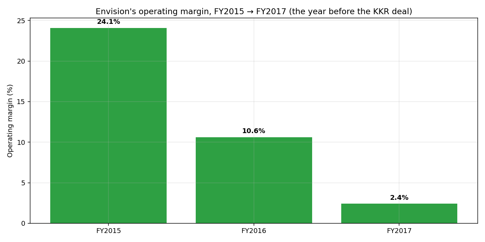
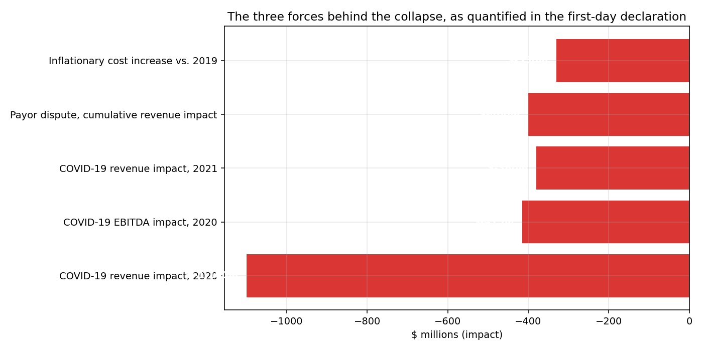

# Envision Healthcare — The Sponsor That Held On

A reconstruction of KKR's 2018 take-private of Envision Healthcare ($9.9B)
through its May 2023 Chapter 11 filing — built entirely from the merger
proxy, the company's own 10-K, and a 177-page bankruptcy court declaration.
No invented numbers; every figure cited.

**The headline**: KKR committed $3.5B of equity against up to $8.05B of
debt financing in 2018, buying a company whose own filings showed operating
margin had already fallen to 2.4%. COVID-19 then cost it ~$1.9B in combined
revenue impact (2020-2021), a specific insurer's adverse payment practices
cost another $400M+, and inflation added $330M more. Two rounds of
pre-bankruptcy debt exchanges (2020, 2022) captured over $1.6 billion of
paper discount — "extend and pretend" — but $7.7 billion of debt still
remained when it filed Chapter 11 in May 2023. **Unlike Red Lobster's
sponsor, KKR never left** — it still held 99.67% of the equity at filing,
and had even bought ~$399M of the company's own distressed debt along the
way. In October-November 2023, creditors led by PIMCO converted their debt
into equity, splitting the company into two independent firms and
eliminating ~70% of its debt.

This is the third in a series of failed-LBO case studies — see also
[toys-r-us-lbo-case-study](https://github.com/bolatbekm/toys-r-us-lbo-case-study)
(sponsor holds debt for 12 years) and
[red-lobster-lbo-case-study](https://github.com/bolatbekm/red-lobster-lbo-case-study)
(sponsor exits 4 years before the collapse). Here, the sponsor stayed the
whole way — and the collapse had multiple, separately-quantified causes
rather than one single structural flaw.

## What's in this repo

| Path | What it is |
|---|---|
| [`docs/sources.md`](docs/sources.md) | Every figure cited — including the honest 2018-2022 annual-data gap and a noted disagreement across sources on KKR's exact residual stake |
| [`docs/deal_narrative.md`](docs/deal_narrative.md) | The plain-language story, year by year |
| [`notebook/envision_analysis.ipynb`](notebook/envision_analysis.ipynb) | Python analysis: the pre-deal margin collapse, the 2018 financing mix, the three quantified crisis forces, the liability-management rounds, and the dual-silo debt structure |
| [`model/EnvisionHealthcare_LBO_Model.xlsx`](model/EnvisionHealthcare_LBO_Model.xlsx) | A formula-driven Excel model — the only one of the three with zero illustrative-assumption cells, since every figure here traces directly to a cited source |
| [`data/processed/`](data/processed/) | Clean CSVs feeding both the notebook and the Excel model |
| [`data/raw/`](data/raw/) | The actual source documents — the 2017 10-K and the 177-page first-day declaration — kept verbatim |

## The headline charts



KKR bought a company whose own numbers already showed a shrinking margin.



COVID, a specific payor dispute, and inflation — each independently
quantified in the company's own bankruptcy declaration.

More charts (the liability-management rounds, the dual-silo debt
structure) are in the notebook and in `assets/`.

## How to reproduce this

```bash
pip install -r requirements.txt

python scripts/build_processed_data.py

cd notebook && python build_notebook.py && jupyter nbconvert --to notebook --execute --inplace envision_analysis.ipynb

cd ../model && python build_excel_model.py
```

## What this is not

Envision deregistered from SEC reporting immediately after the 2018 deal
closed, so no continuous 2018-2022 annual financial panel exists — this
project does not estimate one. Where press sources disagree on KKR's exact
residual ownership stake after the 2023 restructuring, both versions are
shown in `docs/sources.md` rather than resolved by guessing.
